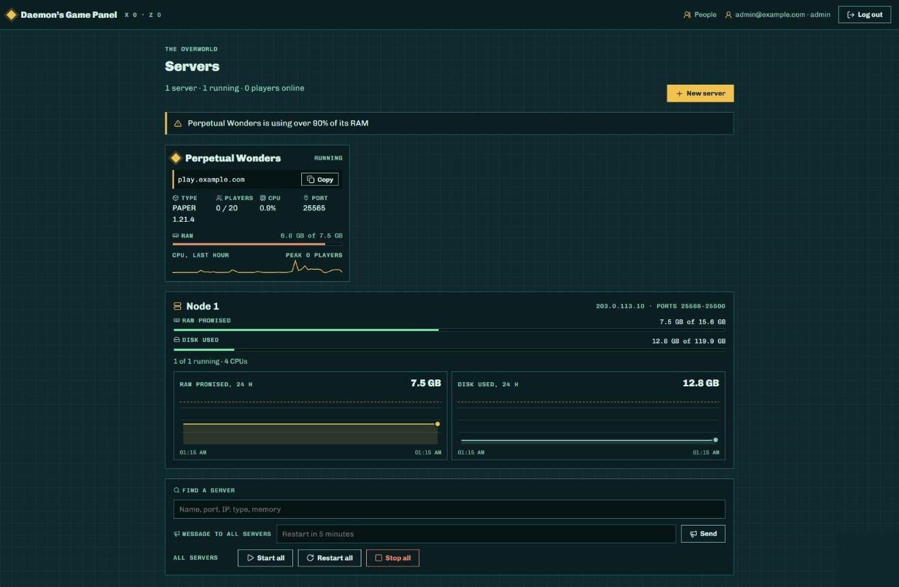
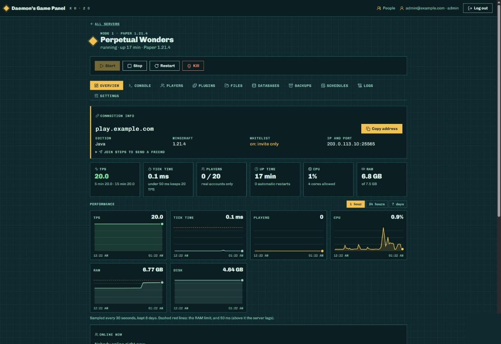
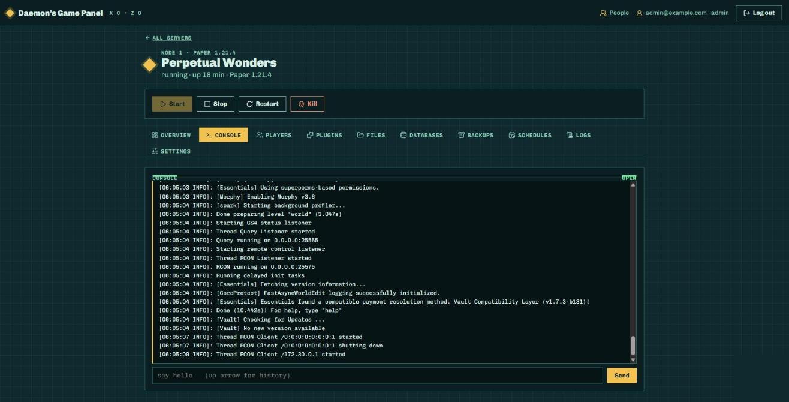
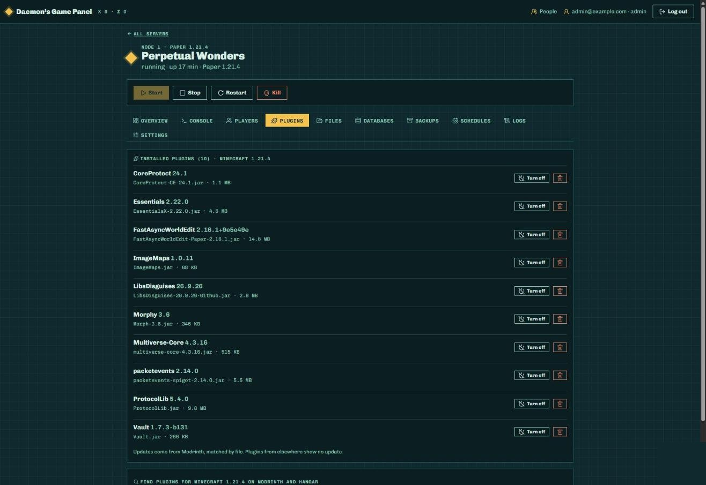
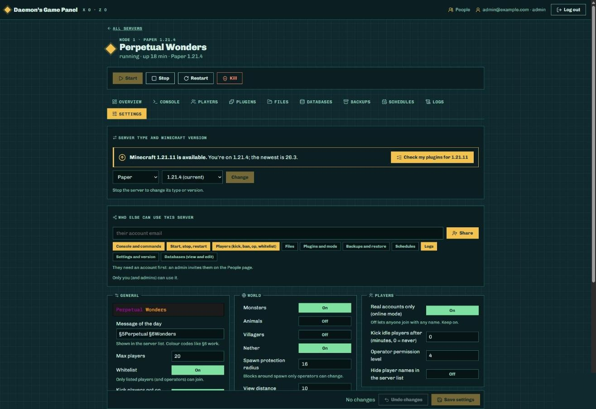
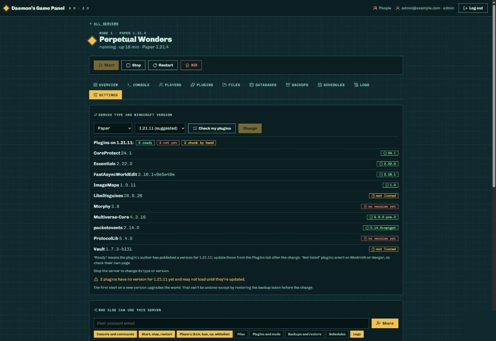
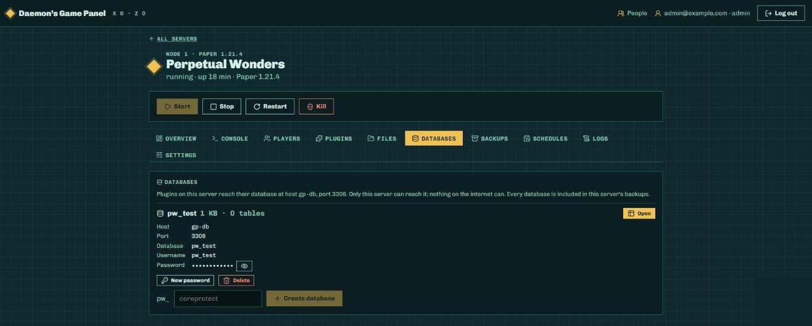
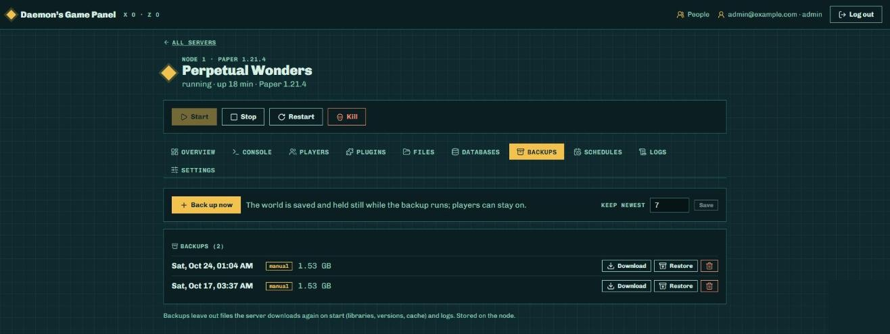

# Daemon's Game Panel

A self-hosted control panel for Minecraft servers. Run servers on your own machines,
share them with friends, and give each person exactly the access they need: console,
players, plugins, files, databases, backups and more, from one web page.



- **Your hardware, your rules.** The panel and the game servers run on machines you own.
- **Made for sharing.** Invite people, hand a server to its owner, or give a friend only the console.
- **Safe by default.** Backups before every risky change, snapshots before every database edit,
  and game servers that can't reach each other or your private network.

---

## Contents

- [Features](#features)
- [How it fits together](#how-it-fits-together)
- [Requirements](#requirements)
- [Installing](#installing)
- [Admin commands](#admin-commands)
- [Development](#development)
- [Security](#security)

---

## Features

### Dashboard

Every server at a glance: status, address to copy, players, CPU, RAM and a one-hour trend line.
Admins also see each game machine's memory and disk, with 24-hour graphs, plus warnings when a
server runs low on resources. Send a message to every server at once, or start, restart and stop
them all.

### Server overview



Connection details and join steps to send a friend, live TPS and tick time, players, uptime,
CPU and RAM, and performance graphs over 1 hour, 24 hours or 7 days.

### Live console



The server console in the browser, with command history. Every command is recorded in the audit log.

### Plugins and mods



- See every installed plugin (Paper, Purpur) or mod (Fabric, Forge, NeoForge) with its version.
- Turn plugins off and on, or move them to the trash.
- Search **Modrinth** and **Hangar** for plugins that fit the server's Minecraft version and
  install them in one click. Files are only taken from the sites' own servers and checked against
  their published hash.
- Updates are offered when a newer stable release exists for your Minecraft version.

### Minecraft version updates



When a newer Minecraft version is out, the Settings tab says so. Pick from the real list of
versions and press **Check my plugins** to see, before changing anything, which plugins are ready:



Changing the version always stops the server, takes a backup, then switches. The right Java
version is picked automatically (Java 25 for the yearly 26.x releases).

### Databases



Give plugins a real MariaDB database, created in one click:

- Connection details to paste into a plugin's config (host `gp-db`, port `3306`).
- Browse tables and rows, edit or delete a single row, or run a query.
- Queries are **read-only** unless *Allow changes* is ticked, which shows a warning and asks again.
- A snapshot is saved before every change, every change is logged, and databases are included in
  the server's backups.
- Each server reaches its databases over its own private link; servers can't see each other's.

### Backups and schedules



Back up while players stay on (the world is held still while the archive is made), keep the
newest N, download or restore. Schedules run backups, restarts, commands or chat messages every
N minutes or at set times of day, in your time zone.

### Everything else

- **Players:** who's online, kick, ban, op, whitelist, and everyone the server has ever seen.
- **Files:** browse, edit with a code editor, upload (large files in pieces), download, rename, delete to trash.
- **Logs:** current and older logs plus crash reports, searchable, with errors highlighted.
- **Settings:** `server.properties` as a form, with a coloured preview of the server list message (MOTD).
- **People:** invite links, roles (admin, owner, subuser), per-server permissions, quotas,
  disk caps and two-step login.

---

## How it fits together

```
                 Browser
                    │  HTTPS (optionally through a Cloudflare Tunnel)
          ┌─────────▼──────────┐
          │      Panel VM      │  Vue 3 web app + Fastify API + PostgreSQL
          └─────────┬──────────┘
                    │  HTTPS with a pinned certificate and a per-node token
   ┌────────────────▼─────────────────┐
   │      Game machine ("node")       │  Node.js agent + Docker
   │  ┌──────────┐  ┌──────────┐      │
   │  │ server A │  │ server B │ ...  │  itzg/minecraft-server containers
   │  └────┬─────┘  └────┬─────┘      │
   │       └─private─┐   └─private┐   │
   │              ┌──▼────────────▼┐  │
   │              │  gp-db MariaDB │  │  started the first time a database is created
   │              └────────────────┘  │
   └──────────────────────────────────┘
```

| Part | Where | What it does |
|---|---|---|
| `apps/panel-web` | Panel VM | The web app (Vue 3, Vite). |
| `apps/panel-api` | Panel VM | Accounts, permissions, audit log, metrics; talks to the nodes. Fastify + Drizzle + PostgreSQL. |
| `apps/agent` | Each node | Runs the game containers, files, backups, RCON, databases. Only the panel can call it. |
| `packages/shared` | Both | Types and validation shared by all three. |
| `deploy/panel` | Panel VM | Dockerfile and Compose file (PostgreSQL, panel, optional Cloudflare Tunnel). |
| `deploy/node` | Each node | systemd units for the agent and the node firewall. |

---

## Requirements

- **Panel VM:** Docker with Compose. 2 cores and 4 GB RAM or more is comfortable.
- **Each node:** Linux with Docker, Node.js 24 and pnpm, and a disk for server data
  (XFS with project quotas if you want per-server disk caps).
- A domain for the panel and for players' addresses (optional; servers also work by IP and port).

---

## Installing

### 1. A node (game machine)

```bash
# Code and dependencies
sudo git clone https://github.com/DaemonAlex/gamepanel /opt/gamepanel
cd /opt/gamepanel && pnpm install --frozen-lockfile
pnpm --filter @gamepanel/shared build && pnpm --filter @gamepanel/agent build

# Settings: copy and fill in (token, TLS certificate, addresses)
sudo mkdir -p /etc/gamepanel
sudo cp deploy/node/agent.env.example /etc/gamepanel/agent.env && sudo chmod 600 /etc/gamepanel/agent.env

# Firewall and agent services
sudo install -m 755 deploy/node/gamepanel-firewall.sh /usr/local/sbin/gamepanel-firewall
sudo cp deploy/node/gamepanel-firewall.service deploy/node/gamepanel-agent.service /etc/systemd/system/
sudo systemctl daemon-reload && sudo systemctl enable --now gamepanel-firewall gamepanel-agent
```

The agent listens with TLS on `AGENT_HOST:AGENT_PORT` (8443 by default). Keep that port reachable
from the panel only.

### 2. The panel

```bash
git clone https://github.com/DaemonAlex/gamepanel && cd gamepanel/deploy/panel
cp .env.example .env && chmod 600 .env     # set POSTGRES_PASSWORD, APP_SECRET, SERVER_DOMAIN
docker compose up -d --build
# With a Cloudflare Tunnel: put TUNNEL_TOKEN in .env, then
docker compose --profile tunnel up -d
```

The panel listens on `127.0.0.1:3000` on its VM; publish it through the tunnel or your own reverse proxy.

### 3. First admin and first node

```bash
cli() { docker compose exec panel node apps/panel-api/dist/cli.js "$@"; }
cli create-admin --email you@example.com
cli add-node --id node1 --name "Node 1" --url https://10.0.0.20:8443 \
    --token-file agent-token.txt --ca-file agent-cert.pem \
    --public-ip 203.0.113.10 --ports 25565-25600
```

Log in, press **New server**, and you're running.

---

## Admin commands

Run on the panel VM: `docker compose exec panel node apps/panel-api/dist/cli.js <command>`

| Command | What it does |
|---|---|
| `create-admin --email E` | Creates an admin and prints a one-time password. |
| `add-node --id … --url … --token-file … --ca-file … --public-ip … --ports A-B` | Registers a game machine. |
| `register-server --id … --name … --node … --owner E --type PAPER --version 1.21.4 --memory 6144 --cpus 4 --port 25565` | Adopts a server that already runs on a node. |
| `invite --email E --role subuser\|owner\|admin [--give-server ID]` | Prints a one-time join link (valid 7 days). |
| `rebuild --id ID [--start]` | Backs up a stopped server, then recreates its container so new defaults apply. |

---

## Development

```bash
pnpm install
pnpm --filter @gamepanel/shared build
pnpm -r typecheck
pnpm -r test

# Web app with hot reload (expects the API on :3000)
pnpm --filter @gamepanel/panel-web dev
```

The database feature has end-to-end tests against a real MariaDB. Run them only on a throwaway
machine with Docker, since they create and remove a `gp-db` container:

```bash
cd apps/agent && DB_IT=1 GP_IT_ROOT=/tmp/gp-it npx vitest run src/databases.it.test.ts
```

---

## Security

- The agent accepts calls only from the panel: TLS with the node's own pinned certificate, plus a token.
- Game containers run as an unprivileged user with all Linux capabilities dropped, and can't talk to each other.
- The node firewall keeps containers off private address ranges and off the node itself.
- Each server's database link is an internal network with no route out.
- Sessions, invite links and node tokens are stored hashed or encrypted.
- Every action that changes something is written to the audit log with who, when and from where.
